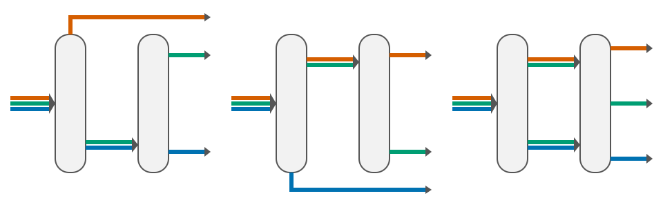

# Distillation configurations

The number of ways to separate a mixture of n components into its n pure components with n - 1
distillation columns, where every column has one reboiler and one condenser. These are the basic
configurations of Shah and Agrawal's matrix method. From n = 3 on, every one of them can also have
some of its heat exchangers swapped for thermal couplings, and the number of thermally coupled
configurations is counted here too.

Shah and Agrawal tabulated both counts up to n = 8 (Table 1 of their Distillation Absorption 2010
paper). The programs here take them to n = 16. They grow fast: at n = 16 there are about 3.8 * 10^33
basic configurations and 4.6 * 10^41 thermally coupled ones.

## The sequences

Basic configurations, for n = 1, 2, 3, ...

```
1, 1, 3, 18, 203, 4373, 185421, 15767207, 2705855923, 937391956005, 654480863962718,
919195862157434812, 2592622191945960123211, 14666791399160327725631911,
166260917759076570415443222370, 3774157852261969720740508299891612
```

Thermally coupled configurations, for n = 1, 2, 3, ...

```
0, 0, 5, 134, 5925, 502539, 85030771, 29006926681, 19982100214349, 27766192419343579,
77690438485880180130, 436973951875406274001988, 4933559967564433839720830133,
111686612809264140599483788404313, 5065504957381703727322612792688648350,
460016128014019312789006468068698768829540
```

Both are in `terms.txt`.

## Definition

Number the components 1 to n, most volatile first, and write [i,j] for the stream that has
components i through j. The feed is [1,n] and the pure products are [1,1] to [n,n]. These are the
spots of the upper triangular matrix in Shah and Agrawal's method, and the (n - 2)(n + 1)/2 spots
that aren't the feed or a product can each be in or out. A set of streams is a basic configuration
if it has the feed and all n products, and

- every stream with more than one component is the union of a shorter stream in the set that
  starts where it starts and a shorter one that ends where it ends. Those are the top and bottom
  products of its split, and they're allowed to overlap.
- every stream other than the feed comes out of some split, so a longer stream in the set starts
  where it starts or ends where it ends.

These are Shah and Agrawal's two checks (every stream but the feed is produced by another one, and
no component gets lost in a column) written for intervals. They're also constraints (H2) to (H5) of
the MINLP formulation of Tumbalam Gooty, Agrawal and Tawarmalani. Splits that make a common product
go in the same column (their step 6).

In a basic configuration the condensers and reboilers that make submixtures (streams sent on to
another column) can be replaced by thermal couplings, two-way vapor and liquid connections between
the columns. The DOE report on the method says a basic configuration with p places for a thermal
coupling has 2^p - 1 thermally coupled ones. Taking p to be the number of submixtures that come out
of exactly one split gives Shah and Agrawal's counts for n = 3 to 8, and that's what is counted
here.

## Example

For n = 3, with components A, B and C, there are three basic configurations:



Orange, green and blue are A, B and C, most volatile first, and a stream drawn with more than one
stripe is a mixture. Left to right:

- ABC into A and BC, then BC into B and C
- ABC into AB and C, then AB into A and B
- ABC into AB and BC, then both go into one second column that gives A at the top, B from the
  middle and C at the bottom

All three use two columns. The first two each have one submixture (BC or AB) and give one
thermally coupled configuration each. The third has two, AB and BC, and gives 2^2 - 1 = 3. So
there are 5 thermally coupled configurations at n = 3.

## Files

- `rows/sadp4.cpp` counts both, going through the components one row at a time (row i is the
  streams that start at i). Between rows it only has to remember a few bits per column that is
  still open, so configurations that agree on those get counted together, and the states live on
  disk between rows. Build with `g++ -O3 -std=c++17 -static -o sadp4.exe sadp4.cpp` (Windows,
  MinGW) and run `sadp4.exe n chunk_states workdir [headroom_GB]`. It can be stopped and restarted
  after any finished row.
- `rows/crt.py`: the thermally coupled count passes 128 bits at n = 16 (the basic one at 17), so
  `sadp4` prints both mod 2^128 and mod 2^61 - 1 and this puts them back together.
- `rows/rowdp_disk.cpp` is the second row sweep program, written separately from `sadp4`. Same rows
  and states, but the counts are exact (128 bits for the basic one, 192 for the other, no CRT) and a
  row's states are summed in a hash table, in several passes, instead of in sorted runs. Build with
  `g++ -O2 -std=c++17 -static -o rowdp_disk.exe rowdp_disk.cpp -lpsapi` and run
  `rowdp_disk.exe n M log2_slots workdir headroom_GB maxmem_GB` (n = 16 was `16 4 26 workdir 130 9`).
  It can be stopped and restarted any time.
- `lengths/lendp2.cpp` counts both a different way, adding streams shortest first. Its states have
  nothing in common with the row sweep's. It gets to n = 12, which needs about 8 GB.
- `brute/tc_bf.c` tries every set of streams and checks the two rules directly, for n up to 9
  (2^35 sets at n = 9).
- `brute/printed_rules.py` does the same from the method's own wording instead of from the interval
  rules: the three checks as the DOE report prints them, done literally, up to n = 7. It also shows
  that the third check (at least n - 2 submixtures) never removes anything. Standard library only.
- `figure/n3.py` draws `figure/n3.svg`. It first finds every n = 3 configuration from the two
  rules and groups splits that make a common product into one column, and only draws if that
  matches the picture. Standard library only; run it from the `figure` folder.
- `terms.txt` lists n and both counts for n = 1 to 16.

## Checks

- For n = 3 to 8 both counts are the published ones.
- The printed checks, done literally, give the published basic counts up to n = 7, same as the
  interval rules. Dropping either of the first two checks changes the counts, so both are doing
  something.
- For n up to 9 the brute force gives the same counts, checking every set.
- For n up to 12 the length sweep and the row sweep agree on both counts.
- From n = 13 on the terms come from the row sweep only, so they rest on one method. Two row sweep
  programs written separately agree on both counts and on the number of states after every row.
- `sadp4 ... --break-merge` turns off the summing of equal states in the disk merge, and the answer
  then comes out wrong, so the merge really is being tested. Running with tiny chunks, so that
  everything goes through the merge, gives the same answers as one big chunk.

## References

- V. H. Shah and R. Agrawal, Multicomponent distillation configurations with large energy savings,
  in Distillation Absorption 2010, A. B. de Haan, H. Kooijman and A. Górak (eds.), 61-66.
  [PDF](https://skoge.folk.ntnu.no/prost/proceedings/distillation10/DA2010%20Conference%20Proceedings/1.%20Energy%20Efficiency/OR03%20Shah%20Multicomponent%20Distillation%20Configurations.pdf)
- V. H. Shah and R. Agrawal, A matrix method for multicomponent distillation sequences, AIChE
  Journal 56 (2010), 1759-1775. [doi:10.1002/aic.12118](https://doi.org/10.1002/aic.12118)
- Z. Jiang and R. Agrawal, Process intensification in multicomponent distillation: A review of
  recent advancements, Chemical Engineering Research and Design 147 (2019), 122-145.
  [doi:10.1016/j.cherd.2019.04.023](https://doi.org/10.1016/j.cherd.2019.04.023)
- R. Tumbalam Gooty, R. Agrawal and M. Tawarmalani, An MINLP formulation for the optimization of
  multicomponent distillation configurations, Computers & Chemical Engineering 125 (2019),
  13-30. [doi:10.1016/j.compchemeng.2019.02.013](https://doi.org/10.1016/j.compchemeng.2019.02.013)
- R. Agrawal, New design methods and algorithms for highly energy-efficient and low-cost
  multi-component distillation processes, final technical report DE-FG36-06GO16104, Purdue
  University, 2013. [OSTI 1113224](https://www.osti.gov/biblio/1113224)

## License

MIT
